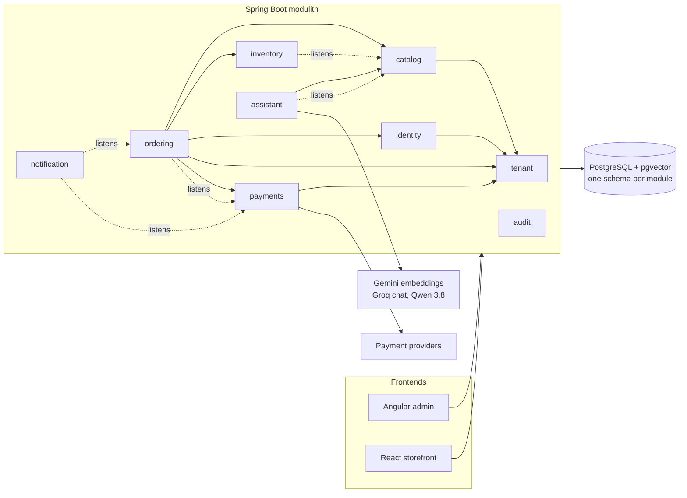

# SME Commerce Platform

A multi-tenant online shop platform for small Kenyan businesses, in the style of Shopify. Each shop
signs up, adds its products, and gets its own storefront. Customers order without an account and pay by
M-Pesa or card. The order turns Paid on its own, and both the customer and the shop see it happen live.
Each shop also gets an assistant that answers questions from that shop's own products and policies.

It is one Spring Boot application split into modules with enforced boundaries (a "modulith"), with an
Angular admin for shop staff and a React storefront for customers.

## What it does

| For | Feature |
| --- | --- |
| Shop owners and staff | Sign up, log in (JWT with rotating refresh tokens), products and categories, stock with a full history, orders with a live feed, payment method settings, assistant documents |
| Customers | Browse a shop, cart, checkout with no account, pay, watch the order status change live, ask the shop's assistant |
| Payments | One provider interface with three providers: M-Pesa through Safaricom's Daraja API (STK push), Stripe test mode for cards, and a fake provider for development. Callbacks are idempotent; a status-query job settles payments whose callback never came; unpaid orders expire and release their stock |
| Safety | Every query names the shop, with cross-shop tests in every module. Rate limits, CORS, an audit log of sensitive changes, and one correlation id that follows an order through the logs |

## Architecture



- **Modules talk only through public APIs or events.** Solid arrows are calls, dotted arrows are events.
  `ModularityTests` fails the build if a module uses another module's internals or creates a cycle. It also
  regenerates the diagrams in [docs/modules](docs/modules).
- **Events are delivered at least once.** They are stored in the same transaction as the change, so a
  crash never loses one (ADR 0009).
- **Money** is integer minor units with a currency code. **Phones** are normalised to `2547XXXXXXXX` and
  never logged in full.
- **"Unknown" is a real payment state.** A customer is never told "failed" when the truth isn't known yet.

## Stack

Java 25, Spring Boot 4.1, Spring Modulith 2, Spring Security (OAuth2 resource server, HS256), Spring AI 2,
PostgreSQL 17 with pgvector, Flyway, Testcontainers. Angular 22 for the admin; React 19, Vite and
TypeScript for the storefront; typed API clients generated from the OpenAPI description. Docker, GitHub
Actions, Render and Vercel.

## Run it locally

You need Java 25, Node 24 and Docker.

1. Copy `backend/.env.example` to `backend/.env` and set `JWT_SECRET` (`openssl rand -base64 48`). The
   API keys are optional: without them, the related feature says it isn't set up.
2. Start the backend from `backend/`. Spring Boot starts Postgres from `compose.yaml` for you.

   ```bash
   ./mvnw spring-boot:run
   ```

3. Start the admin from `admin-angular/` (http://localhost:4200).

   ```bash
   npm install && npm start
   ```

4. Start the storefront from `storefront-react/` (http://localhost:5173/s/your-shop-slug).

   ```bash
   npm install && npm run dev
   ```

The fake payment provider picks its outcome from the phone's last digit: 0 pays, 1 is cancelled, 2 is a
wrong PIN, 3 never answers, 4 is declined, 6 pays but the callback is lost, and 7 times out.

To run the whole backend in Docker, the way Render runs it:

```bash
docker compose -f infra/compose.yaml up --build
```

## Tests

```bash
cd backend && ./mvnw verify
```

The backend has over 300 tests against a real Postgres (Testcontainers), including the module boundary
test and cross-shop tests. The frontends run `npm test`. CI runs all of them on every pull request, plus
a secret scan, a dependency CVE scan and a Docker image build.

The assistant also has a 15-question evaluation with real models (`AssistantEvaluationTests`): two
shops, questions each shop's text answers, and questions about the other shop that it must not answer.
It scores **15 of 15** with Gemini embeddings and Qwen 3.8 on Groq
([results](docs/assistant-evaluation.md)). It is run on request, because it calls the real APIs.

## Decisions

Every significant choice is an Architecture Decision Record in [docs/adr](docs/adr): module rules,
where security lives, tenant filtering, payments, live updates over SSE, the assistant, hardening and
deployment. The design documents are in [docs](docs), and deployment steps in [docs/deploy.md](docs/deploy.md).

## What I would do next

- **Per-shop payment credentials.** Each shop's M-Pesa and Stripe keys, encrypted, instead of one platform
  account; and a nightly comparison with the M-Pesa statement.
- **Several backend instances.** Live updates and rate limits live in each instance's memory today.
  Scaling out needs a shared broker (Redis or Postgres LISTEN/NOTIFY) for SSE, and a shared store for limits.
- **A real `tenant_id` column for vector search.** pgvector filters after the index scan, so with many
  shops a small shop could get too few matches.
- **Customer accounts, refunds and staff invites**, which the design covers but v1 leaves out.
